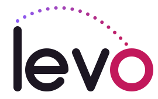

<p align="center">
  <picture>
    <source media="(prefers-color-scheme: dark)" srcset="docs/brand/levo-logo-dark.svg">
    
  </picture>
</p>

<p align="center"><strong>Encurte links e acompanhe cada clique.</strong></p>

<!-- Quando o site estiver no ar, troque "em breve" pelo link, ex.: <a href="https://levo.dev.br">levo.dev.br</a> -->
<p align="center">Site: <em>em breve</em></p>

# Levo

Encurtador de URLs com relatório de cliques.

- **Links curtos** com validade de 1, 7 ou 30 dias, ou sem validade.
- **Relatório por link**: cliques por dia, país, estado, origem, navegador, sistema e dispositivo, com as prévias de WhatsApp, Slack e afins contadas à parte, como compartilhamentos.
- **Privacidade**: o IP do visitante nunca é gravado; visitantes únicos vêm de um hash com sal diário.
- **Contas** com login obrigatório para criar links, e tema claro e escuro.

**Stack**: FastAPI, MongoDB e Redis (RQ) no [backend/](backend/); React, Vite, TypeScript e TanStack Query no [frontend/](frontend/).

## Rodando localmente

Requer Docker, [uv](https://docs.astral.sh/uv/) e Node.

```bash
docker compose up -d                       # MongoDB e Redis

cd backend
cp .env.example .env                       # troque o JWT_SECRET (instruções no arquivo)
uv sync
uv run uvicorn app.main:app --reload       # API em http://localhost:8000 (Swagger em /docs)

# em outro terminal, em backend/: worker que grava os cliques
uv run rq worker --worker-class rq.worker.SimpleWorker --url redis://localhost:6379/0 clicks

# em outro terminal
cd frontend
npm install
npm run dev                                # http://localhost:5173
```

País e estado dos cliques exigem a base GeoLite2: veja [docs/geolite.md](docs/geolite.md). Quando a API mudar, `npm run gen:api` (em `frontend/`, com a API de pé) regera os tipos do front.

## Testes

```bash
(cd backend && uv run pytest && uv run ruff check .)     # usa o Mongo e o Redis do compose
(cd frontend && npm test && npm run lint && npm run build)
```

## Proteção contra abuso

Encurtadores abertos são muito usados para espalhar phishing e spam. As defesas:

- **Login obrigatório** para criar links: todo link tem um dono.
- **Rate limit** por usuário na criação de links e por IP no cadastro e no login.
- **Recusa** de links para o próprio serviço e para outros encurtadores.
- **CSRF** barrado pela checagem de `Origin`, com sessão em cookie `httpOnly` e `SameSite=Lax`.

O que ficou de fora, como checagem contra listas de URLs maliciosas e moderação, está nos riscos aceitos de cada plano.

## Documentação

| Documento | Conteúdo |
|---|---|
| [Fase 1](docs/plan-phase-1.md) | criação de links, redirecionamento e TTL |
| [Fase 2.1](docs/plan-phase-2.1.md) | usuários, JWT, expiração, rate limit e rotas da API |
| [Fase 2.2](docs/plan-phase-2.2.md) | métricas de cliques, worker e relatório |
| [Front](docs/plan-frontend-phase-2.md) | telas, sessão, visual e temas |
| [Deploy](docs/plan-deploy.md) | publicação com custo zero (Vercel, Render, Atlas) |
| [GeoLite](docs/geolite.md) | configuração e obrigações da licença |
| [Marca](docs/brand/levo-logo.html) | logotipo, ícone e cores |

---

This product includes GeoLite Data created by MaxMind, available from https://www.maxmind.com.
